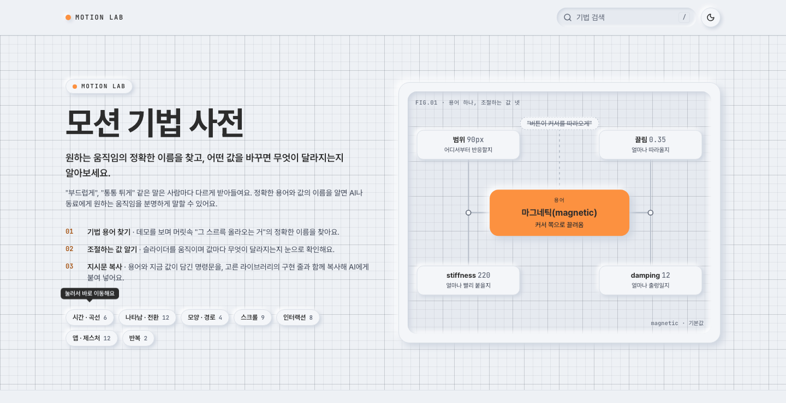
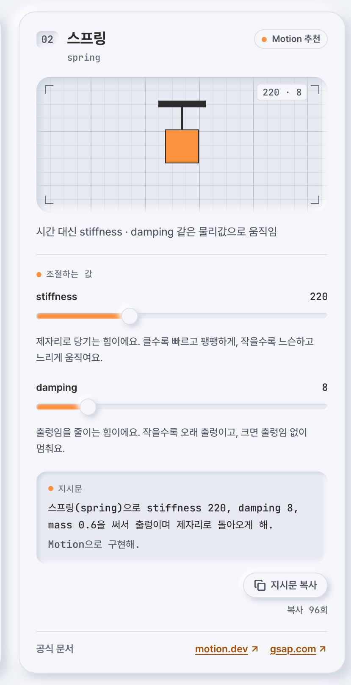

# Motion Lab

모션 기법 사전. 원하는 움직임의 정확한 이름을 찾고, 어떤 값을 바꾸면 무엇이 달라지는지 데모로 확인할 수 있습니다. 웹(Motion · GSAP · CSS)과 앱(React Native) 기법을 함께 다룹니다.

<picture>
  <source media="(prefers-color-scheme: dark)" srcset="docs/preview-dark.png">
  
</picture>

"부드럽게", "통통 튀게" 같은 말은 사람마다 다르게 받아들입니다. Motion Lab은 모션을 `스태거`, `마스크 리빌`, `오버슈트`처럼 업계에서 통하는 표준 용어로 정리하고, 기법마다 `stiffness`, `damping` 같은 값이 무엇을 바꾸는지 보여 줍니다. 찾은 용어와 지금 값은 명령문 지시문으로 복사해 AI에게 그대로 전달할 수 있습니다.

## Features

- **기법 사전**: 모션 기법을 한글 표준 용어와 원어로 정리하고, 카드마다 실시간 데모를 보여 줍니다.
- **조절하는 값**: 슬라이더가 있는 기법은 값을 움직이면 데모가 그 값으로 다시 재생되고, 값마다 바꾸면 무엇이 달라지는지 설명이 붙어 있습니다.
- **앱 · 제스처 (React Native)**: 스와이프 액션, 바텀시트 스냅, 당겨서 새로고침, 인터럽트 가능한 전환, 누르기 피드백, 롱프레스 메뉴, 컨테이너 트랜스폼, 공유 축, 페이드 스루, 푸시 · 팝, 햅틱 동기화, 스켈레톤 로딩 12개를 React Native(Reanimated · Gesture Handler 등) 기준으로 정리했습니다. 데모는 웹에서 같은 움직임을 비슷하게 보여 주고, 지시문의 구현 줄은 React Native API 기준입니다.
- **지시문 미리보기와 복사**: 구현 라이브러리를 고르면 지금 슬라이더 값이 담긴 지시문이 카드 안에 바로 보이고, 버튼 하나로 복사합니다.
- **공식 문서**: 기법마다 motion.dev · gsap.com · MDN · React Native 관련 문서로 이어지는 링크가 있습니다.
- **검색 · 테마**: 기법 이름, 영문 이름, 뜻, 조절하는 값 이름(예: `damping`)으로 찾을 수 있고 (`/` 로 바로 검색), 라이트 · 다크 테마를 지원합니다.
- **어휘집 내보내기**: 전체 기법을 `motion-vocabulary.md` 한 파일로 내보내 다른 프로젝트의 AI 컨텍스트로 쓸 수 있습니다. 어휘집에는 기법별 라이브러리 API와 지시문 예시도 들어 있습니다.



라이브러리를 Motion으로 두고 복사하면 이런 지시문이 만들어집니다.

```
스태거(stagger)로 항목마다 0.12s 간격을 두고, 하나씩 0.5s ease-out-quart로 아래에서 올라오게 해.
구현: Motion — 부모 variant transition: { delayChildren: stagger(0.12) } · 자식 { duration: 0.5, ease: [0.25, 1, 0.5, 1] }
```

## Getting Started

Node.js 20.19 이상 (또는 22.12 이상)이 필요합니다.

```bash
git clone https://github.com/soma0078/motion-lab.git
cd motion-lab
npm install
npm run dev
```

| 명령 | 설명 |
| --- | --- |
| `npm run dev` | 개발 서버 실행 |
| `npm run build` | 타입 검사 후 프로덕션 빌드 |
| `npm run preview` | 빌드 결과 미리보기 |
| `npm run lint` | oxlint 실행 |
| `npm run vocab` | 전체 기법을 `motion-vocabulary.md`로 내보내기 |
| `npm run check:prompts` | 지시문 작성 규칙 검사 |

`vocab` · `check:prompts` 는 `meta.ts` 를 Node 로 바로 읽어서, `.ts` 타입 제거가 기본으로 켜진 Node(24 등)가 필요합니다.

## Tech Stack

React 19 · Vite · TypeScript · Tailwind CSS v4 · [motion](https://motion.dev) · lucide-react · Pretendard · JetBrains Mono

## Project Structure

```
src/components/   헤더 · 히어로 · 기법 카드 · 섹션 제목 · 테마 훅
src/index.css     디자인 토큰 (라이트 · 다크) · 뉴모피즘 그림자 · 설계도 격자
src/techniques/
  <slug>/
    meta.ts     용어 · 뜻 · 섹션 · 추천 · 공식 문서 · 수치 슬라이더와 값마다 효과 설명 · 지시문(prompt) · 라이브러리별 API
    demo.tsx    카드 데모 (default export 컴포넌트 하나)
    demo.css    선택. 데모 전용 스타일
  _shared/      데모 공용 훅 · 부품
  registry.ts   폴더를 자동으로 읽어 섹션별 목록을 만듦
  sections.ts   섹션 순서 · 제목 · 설명
  prompt.ts     슬라이더 기본값 · 지시문 만들기 (카드의 복사 · 어휘집이 같이 씀)
scripts/export-vocabulary.mjs   어휘집 생성
scripts/check-prompts.mjs       지시문 작성 규칙 검사
```

기법 하나가 폴더 하나입니다. 폴더를 추가하거나 삭제하면 홈 화면에 그대로 반영됩니다.

지시문(`meta.ts` 의 `prompt`)은 기법 용어를 `이름(원어)`로 문장 안에 넣고, 문장마다 `~해.`로 끝나는 명령체로 씁니다. `npm run check:prompts`가 이 규칙을 검사합니다.

## Notes

API 표기는 [motion.dev](https://motion.dev/docs), [gsap.com](https://gsap.com/docs/v3/), [MDN](https://developer.mozilla.org)의 공식 문서와 대조했습니다 (2026-10 기준, motion 14 · GSAP 3.15). 이후 버전에서는 달라질 수 있습니다.

React Native 기법은 [Reanimated](https://docs.swmansion.com/react-native-reanimated/) 4.x, [Gesture Handler](https://docs.swmansion.com/react-native-gesture-handler/) 2.x, [React Navigation](https://reactnavigation.org/), [@gorhom/bottom-sheet](https://gorhom.dev/react-native-bottom-sheet/), [Expo Haptics](https://docs.expo.dev/versions/latest/sdk/haptics/) 문서와 대조했습니다 (2026-10). 코드는 문서 기준이며 실제 React Native 앱에서 실행해 확인한 것은 아닙니다.
