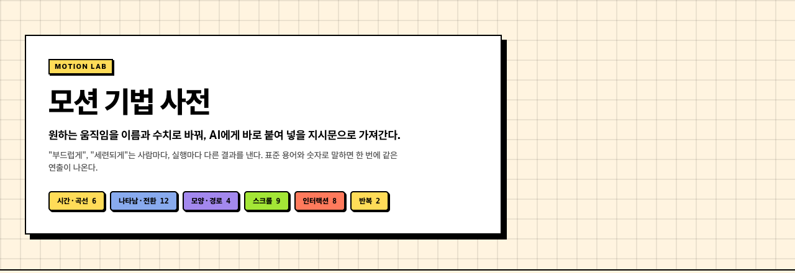
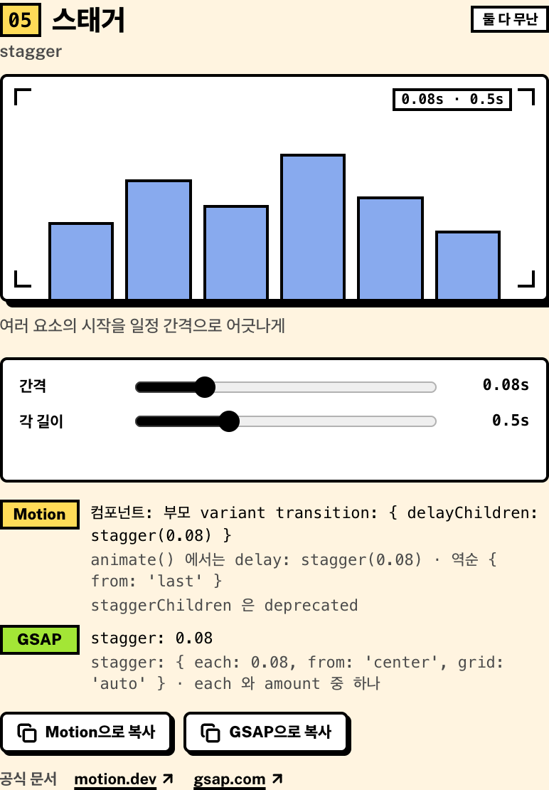

# Motion Lab

모션 기법 사전. 원하는 움직임을 표준 용어와 수치로 바꿔, AI에게 바로 붙여 넣을 지시문으로 가져갈 수 있습니다.



"부드럽게", "세련되게" 같은 말은 사람마다, 실행마다 다른 결과를 냅니다. Motion Lab은 모션을 `스태거`, `마스크 리빌`, `오버슈트`처럼 업계에서 통하는 이름과 숫자로 정리해서, 같은 연출을 한 번에 지시할 수 있게 합니다.

## Features

- **기법 사전**: 모션 기법을 한글 표준 용어와 원어로 정리하고, 카드마다 실시간 데모를 보여 줍니다.
- **도구 비교**: 같은 기법을 Motion · GSAP · CSS로 구현할 때의 핵심 API를 나란히 보여 주고, 어느 쪽이 맞는지, 유료 기능인지 표시합니다. 공식 문서와 대조했으며 링크를 달았습니다.
- **수치 조절과 지시문 복사**: 슬라이더로 간격, 스프링 값 등을 조절하고, 현재 값이 담긴 지시문을 복사합니다.
- **어휘집 내보내기**: 전체 기법을 `motion-vocabulary.md` 한 파일로 내보내 다른 프로젝트의 AI 컨텍스트로 쓸 수 있습니다.



카드에서 "Motion으로 복사"를 누르면 이런 지시문이 만들어집니다.

```
스태거(stagger): 스태거로 0.12s 간격을 두고, 하나씩 0.5s ease-out-quart로 아래에서 올라오게.
구현: Motion — 부모 variant transition: { delayChildren: stagger(0.12) } · 자식 { duration: 0.5, ease: [0.25, 1, 0.5, 1] }
```

## Getting Started

Node.js 20.19 이상 (또는 22.12 이상)이 필요합니다.

```bash
git clone https://github.com/soma0078/motion-lab.git
cd motion-lab
npm install
npm run dev
```

| 명령 | 설명 |
| --- | --- |
| `npm run dev` | 개발 서버 실행 |
| `npm run build` | 타입 검사 후 프로덕션 빌드 |
| `npm run preview` | 빌드 결과 미리보기 |
| `npm run lint` | oxlint 실행 |
| `npm run vocab` | 전체 기법을 `motion-vocabulary.md`로 내보내기 |

## Tech Stack

React 19 · Vite · TypeScript · Tailwind CSS v4 · [motion](https://motion.dev) · lucide-react

## Project Structure

```
src/techniques/
  <slug>/
    meta.ts     용어 · 뜻 · 섹션 · Motion/GSAP/CSS API · 추천 · 공식 문서 · 수치 슬라이더
    demo.tsx    카드 데모 (default export 컴포넌트 하나)
    demo.css    선택. 데모 전용 스타일
  _shared/      데모 공용 훅 · 부품
  registry.ts   폴더를 자동으로 읽어 섹션별 목록을 만듦
  sections.ts   섹션 순서 · 제목 · 설명
  prompt.ts     "복사" 지시문 생성
scripts/export-vocabulary.mjs   어휘집 생성
```

기법 하나가 폴더 하나입니다. 폴더를 추가하거나 삭제하면 홈 화면에 그대로 반영됩니다.

## Notes

API 표기는 [motion.dev](https://motion.dev/docs), [gsap.com](https://gsap.com/docs/v3/), [MDN](https://developer.mozilla.org)의 공식 문서와 대조했습니다 (2026-10 기준, motion 14 · GSAP 3.15). 이후 버전에서는 달라질 수 있습니다.
